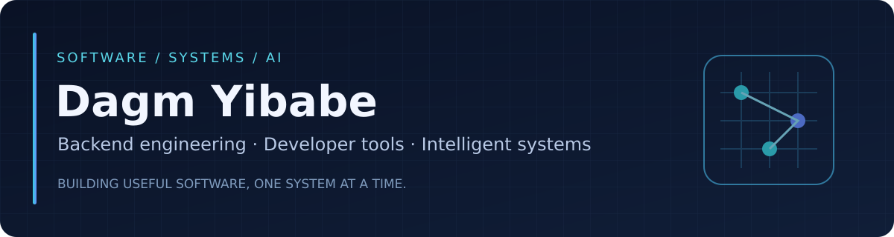

 

**Backend-focused developer · AI/ML explorer · Electrical & Computer Engineering student**

Based in Ethiopia · Addis Ababa University · AI intern at iCog Labs

### `01` / About

I build **backend systems, developer tools, and AI-powered applications**. I enjoy designing APIs, working with databases, and understanding the systems beneath the interface—from secure execution environments to machine learning experiments.

- **Currently building:** developer tooling and practical AI systems
- **Exploring:** neuro-symbolic AI, agent architectures, and system design
- **Engineering interests:** reliability, security, performance, and clean architecture

### `02` / Toolkit

| Area | Technologies |
| :--- | :--- |
| **Languages** |      |
| **Backend** |     |
| **Data & infrastructure** |     |
| **Web & ML** |     |

### `03` / Selected work

| Project | Engineering focus | Built with |
| :--- | :--- | :--- |
| **[SafeRun](https://github.com/dag12y/saferun)** | Sandboxed npm installation and package risk analysis | Go · Docker |
| **[DevPulse](https://github.com/dag12y/DevPulse)** | Developer activity tracking and analytics | Go · Next.js |
| **[EthioNLP](https://github.com/dag12y/ethionlp)** | Ethiopian-language text processing and transliteration | Python · FastAPI |
| **[ChessEvolve](https://github.com/dag12y/chessEvolve)** | Chess AI training and experimentation | Python · ML |
| **[Grover Deployment Solver](https://github.com/dag12y/grover-deployment-solver)** | Quantum search for deployment configuration constraints | Python · Qiskit |

> My projects range from practical backend tooling to experimental AI. I value working implementations, clear documentation, and understanding the tradeoffs behind each design.

### `04` / GitHub activity

Language percentages describe public repository code, not personal proficiency. Third-party stats cards may occasionally be unavailable.

---

**Interested in building something together?**

I'm open to collaborating on backend infrastructure, developer tools, and AI projects.

[Portfolio](https://www.dagmyibabe.me/) · [LinkedIn](https://www.linkedin.com/in/dagmyibabe/) · [Email](mailto:dagmyibabe19@gmail.com)

